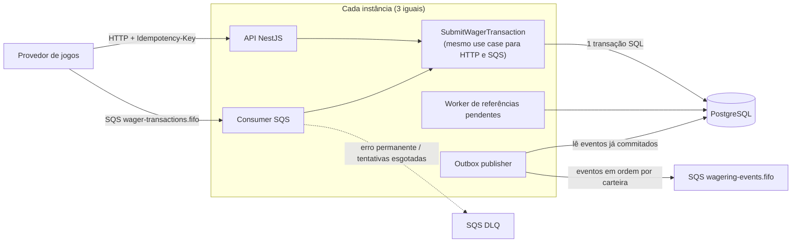

# Distributed Wagering Processor

[](https://github.com/gabrielcavalcant/jungle-wagering-processor/actions/workflows/ci.yml)

Serviço financeiro que processa transações de apostas (`BET → WIN | LOSS | REFUND | ROLLBACK`) vindas de vários provedores de jogos, por **HTTP** e por **fila SQS**. Ele continua correto quando as mensagens chegam **duplicadas**, **fora de ordem** ou **ao mesmo tempo em várias instâncias**, e quando o processo ou o banco caem no meio do caminho.

**Stack:** Bun · TypeScript estrito · NestJS 11 · PostgreSQL 16 · MikroORM 6 · AWS SQS (LocalStack) · Docker Compose

| Documento | Conteúdo |
|---|---|
| **README.md** (este) | o que é, como rodar, comandos, API e testes |
| [**ARCHITECTURE.md**](ARCHITECTURE.md) | decisões, trade-offs, interpretações do enunciado e limitações |
| [**docs/DATABASE.md**](docs/DATABASE.md) · [schema.sql](docs/schema.sql) | diagrama do banco, garantias do schema e consultas prontas |
| [**test/load/RESULTS.md**](test/load/RESULTS.md) | metodologia e resultados do teste de carga |
| **Swagger** em `/docs` | documentação interativa da API (OpenAPI 3) |

## Índice

- [Destaques](#destaques)
- [Pré-requisitos](#pré-requisitos)
- [Início rápido](#início-rápido)
- [Como funciona](#como-funciona)
- [O enunciado, item por item](#o-enunciado-item-por-item)
- [Subindo com Docker](#subindo-com-docker)
- [Comandos](#comandos)
- [Testes](#testes)
- [API](#api)
- [Configuração](#configuração)
- [Estrutura do projeto](#estrutura-do-projeto)
- [Decisões principais](#decisões-principais)
- [Limitações conhecidas](#limitações-conhecidas)
- [Solução de problemas](#solução-de-problemas)

---

## Destaques

- **Dinheiro nunca é `number`:** `Money` guarda centavos em `bigint` e só aceita texto com 2 casas (`"25.00"`). No banco, `numeric(20,2)`.
- **O banco é a última linha de defesa:** saldo não negativo, ledger imutável, idempotência única, reversão única e **saldo = ledger** (conferido no COMMIT) são garantidos pelo próprio PostgreSQL, não só pelo código.
- **Concorrência por carteira:** lock pessimista na linha da carteira (`SELECT … FOR UPDATE` via `LockMode` do MikroORM) mais um update condicional por versão. Carteiras diferentes nunca se bloqueiam.
- **Idempotência persistente:** `Idempotency-Key` única no banco e inbox por mensagem SQS. A mesma aposta enviada **50 vezes em paralelo gera 1 débito**.
- **Nada se perde em falha:** a inbox, o saldo, o ledger e o evento (outbox) são gravados **na mesma transação**. O ack e a publicação só acontecem depois do commit.
- **Provado com processos reais:** **133 testes** contra PostgreSQL e LocalStack de verdade, incluindo 3 instâncias em paralelo, processo morto entre o commit e o ack, todas as instâncias derrubadas no meio da carga, queda real do PostgreSQL e SIGTERM. Tudo roda no CI a cada push.

## Pré-requisitos

| Ferramenta | Versão | Para quê |
|---|---|---|
| [Docker](https://www.docker.com/) + Compose v2 | recente | PostgreSQL, LocalStack e as 3 instâncias |
| [Bun](https://bun.sh/) | 1.4 (testado com 1.4.4) | runtime, gerenciador de pacotes e testes |
| Chrome, Edge ou Brave | qualquer | só para o `bun run swagger:tour` (usa o navegador padrão, se for um destes) |

Portas usadas no host: **5433** (PostgreSQL), **4566** (LocalStack), **3001–3003** (instâncias no Docker) e **3000** (instância local).

## Início rápido

**Ver o desafio inteiro rodando, com um comando:**

```bash
bun install
bun run showcase
```

Ele executa, em ordem, com cada etapa mostrando qual seção do enunciado está provando:

1. Sobe o Docker Compose: PostgreSQL, LocalStack e **3 instâncias**, esperando cada uma ficar saudável.
2. Roda o typecheck.
3. Roda os testes de unidade, integração e concorrência.
4. Faz a demonstração dos cenários nas instâncias do Docker.
5. Mostra os logs e as métricas, e imprime um resumo por etapa.
6. Abre o **Swagger UI** no navegador e executa sozinho todas as operações, enquanto os logs das 3 instâncias aparecem ao vivo.

Flags: `--rapido` (pula a concorrência) e `--sem-testes` (só sobe, demonstra e abre o Swagger).

**Só a API, com o Swagger:**

```bash
bun run swagger
```

Sobe PostgreSQL e LocalStack, aplica as migrations, inicia a API em `http://localhost:3000` e abre `http://localhost:3000/docs`. Em outro terminal, escolha:

```bash
bun run demo
```

Roda os cenários do desafio contra a API e mostra cada resultado no terminal (24 verificações).

```bash
API_URL=http://localhost:3000 bun run swagger:tour
```

Abre o Swagger UI e executa **todas as operações** pelo navegador, devagar e com uma faixa explicando cada passo (16 verificações). Sem `API_URL`, ele usa a instância do Docker (`:3001`).

## Como funciona



**O caminho de uma aposta, dentro de uma única transação no PostgreSQL:**

1. Grava a mensagem na inbox, quando veio pela fila. Se a mensagem já foi processada, devolve o resultado original.
2. **Trava a carteira** (`SELECT … FOR UPDATE`). Quem chegar depois para a mesma carteira espera na fila.
3. Confere a `Idempotency-Key`: mesma key com o mesmo conteúdo devolve o resultado original; com conteúdo diferente, é **409**.
4. Aplica a regra: BET debita, WIN credita, LOSS não mexe, REFUND/ROLLBACK revertem. Se a referência ainda não chegou, a transação fica `PENDING_REFERENCE`.
5. Grava a transação, o novo saldo, a linha do ledger e o evento na **outbox**. Faz o **COMMIT**: o banco confere que saldo = ledger.
6. Só depois do commit responde ao HTTP ou confirma (ack) a mensagem SQS. O publisher envia os eventos da outbox.

Explicação completa no [ARCHITECTURE.md](ARCHITECTURE.md).

## O enunciado, item por item

| Seção | Requisito | Onde está | Como é provado |
|---|---|---|---|
| §4 | Bun, TS estrito, NestJS, PostgreSQL, SQS/LocalStack, Compose, MikroORM, migrations reversíveis | `package.json`, `docker-compose.yml`, `src/infrastructure/persistence/` | typecheck no CI; migrations testadas indo a zero e voltando |
| §5 | Nada de `number` para dinheiro; garantias no schema; sem lock global | `src/domain/money.ts`, `migrations/` | cada constraint testada com SQL direto (`schema-and-atomicity.test.ts`) |
| §6 | Modelo com `create` / `rehydrate`, Money, Wallet, Transaction, Ledger, Inbox, Outbox, eventos | `src/domain/` | 91 testes de unidade |
| §7 | BET/WIN/LOSS/REFUND/ROLLBACK, referência fora de ordem, códigos de falha | `src/application/transaction-processor.ts` | `business-rules.test.ts`, teste 7 de concorrência |
| §8 | Duas apostas de 80.00 num saldo de 100.00; 3 ou mais instâncias | lock da carteira + update por versão | teste 2 de concorrência, repetido 10× com 3 processos |
| §9 | Endpoints, idempotência, status HTTP distintos, reconciliação, health | `src/http/` | Swagger em `/docs`, `bun run demo`, `bun run swagger:tour` |
| §10 | Consumer com inbox, ack após o commit, retry, DLQ, SIGTERM | `src/infrastructure/messaging/wager-consumer.ts` | `messaging.test.ts`, `graceful-shutdown.test.ts`, teste 5 (crash) |
| §11 | Outbox atômica, publishers concorrentes, recuperação | `outbox-store.ts`, `workers.ts` | 3 publishers concorrentes, lease expirada, ordem por carteira |
| §12 | Logs JSON, métricas, health live/ready | `src/infrastructure/observability/` | `/metrics`, `/health/*`, logs do `showcase` |
| §13 | Unidade, integração, concorrência 1–8, invariante final | `test/` | **133 testes**, CI verde |
| §2 | Autenticação (opcional, 0 pontos) | `ProviderIdentityPort` + `ProviderAuthGuard` | desenho com Keycloak no [ARCHITECTURE §11](ARCHITECTURE.md#11-autenticação-não-implementada-por-decisão) |
| Diferencial | Teste de carga | `test/load/load-test.ts` | [RESULTS.md](test/load/RESULTS.md) |

## Subindo com Docker

```bash
docker compose up -d --build --wait
```

| Serviço | Porta no host | Papel |
|---|---|---|
| `postgres` | 5433 | banco (`wagering` para a app, `wagering_test` para os testes) |
| `localstack` | 4566 | SQS: `wager-transactions.fifo`, `wager-transactions-dlq.fifo`, `wagering-events.fifo` |
| `migrate` | — | aplica as migrations uma vez e sai |
| `app-1`, `app-2`, `app-3` | 3001, 3002, 3003 | **três instâncias iguais**: HTTP, consumer SQS, outbox publisher, worker de referências e limpeza |

```bash
curl localhost:3001/health/ready
```

Swagger: **http://localhost:3001/docs** (também em `:3002` e `:3003`).

**Rodando uma instância fora do Docker:**

```bash
bun run infra:up
DB_PORT=5433 bun run migration:up
DB_PORT=5433 PORT=3000 bun run start
```

## Comandos

| Comando | O que faz |
|---|---|
| `bun run showcase` | o processo completo: Docker com 3 instâncias, todos os testes, demonstração, logs e tour do Swagger |
| `bun run swagger` | sobe a infra, as migrations e a API, e abre o Swagger |
| `bun run swagger:tour` | executa todas as operações pelo Swagger UI, no navegador padrão (Chrome, Edge ou Brave) |
| `bun run demo` | demonstração dos cenários do desafio contra a API rodando |
| `bun run start` | sobe uma instância |
| `bun run migration:up` / `migration:down` | aplica / reverte migrations |
| `bun run typecheck` | `tsc --noEmit` em modo estrito |
| `bun run test:unit` | domínio, regras de negócio e classificação de erros (sem I/O, ~2 s) |
| `bun run test:integration` | PostgreSQL + LocalStack reais |
| `bun run test:concurrency` | 3 processos reais da aplicação |
| `bun run test:all` | todos os 133 testes |
| `bun run test:load` | teste de carga → [RESULTS.md](test/load/RESULTS.md) |
| `bun run infra:up` / `infra:down` | sobe só PostgreSQL + LocalStack / derruba e **apaga os volumes** |

## Testes

| Suíte | Qtd. | O que prova |
|---|---|---|
| Unidade (`test/unit`) | 91 | `Money` (escala, `NaN`, `1e5`, 3 casas, moedas), invariantes da `Wallet`, todas as regras por tipo, máquina de estados, hash canônico, classificação de erros (503 × 500) |
| Integração (`test/integration`) | 32 | migrations up/down; **cada constraint** do schema; atomicidade (falha na outbox desfaz tudo); inbox e redelivery; retry → DLQ → `FAILED`; outbox com 3 publishers mantendo a ordem por carteira; retenção; `LockMode`; SIGTERM |
| Concorrência (`test/concurrency`) | 10 | os **8 cenários do §13** com processos reais: 50 duplicatas → 1 débito; 100/80/80; carteiras em paralelo; 3 instâncias com carga mista HTTP + SQS; processo morto entre o commit e o ack; REFUND/ROLLBACK antes da referência; SIGKILL nas 3 instâncias e restart; **queda real do PostgreSQL** |

- **Nada é mockado** nos testes de integração e concorrência. Eles usam o banco `wagering_test` e criam filas próprias a cada execução, sem tocar no ambiente de desenvolvimento. O mock em memória (`test/support/in-memory.ts`) serve só aos testes de unidade das regras.
- **Invariante final** verificada ao fim de todos eles: `saldo == Σ ledger`, ledger encadeado (`balance_before` = `balance_after` anterior), nenhum saldo negativo, no máximo um lançamento por transação.
- **CI** (GitHub Actions): typecheck e unidade, depois integração e concorrência com PostgreSQL + LocalStack via Docker Compose, a cada push.
- **Carga:** 3 instâncias, 64 clientes simultâneos e 30% do tráfego numa única carteira "quente". Resultado: 55–74 req/s num notebook de 2 núcleos, **0% de erro** e reconciliação consistente em todas as carteiras. Detalhes e análise em [RESULTS.md](test/load/RESULTS.md).

Os testes de integração e concorrência precisam da infra no ar (`bun run infra:up`).

## API

| Método | Rota | Descrição |
|---|---|---|
| `POST` | `/wallets` | cria carteira (+ transação `OPENING` e crédito no ledger, na mesma transação SQL) |
| `GET` | `/wallets/:walletId` | saldo e versão |
| `GET` | `/wallets/:walletId/ledger?cursor=&limit=50` | extrato paginado por keyset (cursor opaco e estável) |
| `POST` | `/wallets/:walletId/reconciliation` | compara o saldo guardado com o ledger; **não corrige** |
| `POST` | `/wagering/transactions` | submete transação (header `Idempotency-Key` obrigatório) |
| `GET` | `/wagering/transactions/:transactionId` | consulta por id interno |
| `GET` | `/providers/:providerId/wagering/transactions/:externalTransactionId` | consulta pelo id do provedor |
| `GET` | `/health/live` · `/health/ready` | processo vivo · PostgreSQL e SQS alcançáveis (sem autenticação) |
| `GET` | `/metrics` | métricas Prometheus |
| `GET` | `/docs` · `/docs/openapi.json` | Swagger UI · contrato OpenAPI 3 |

### Códigos HTTP (iguais em todos os endpoints)

| Status | Significado | O provedor deve… |
|---|---|---|
| `201` | transação nova, `PROCESSED` | — |
| `200` | replay idempotente (`idempotentReplay: true`), com o resultado original | — |
| `202` | aceita, `PENDING_REFERENCE` (aguardando a referência) | consultar depois ou reenviar com a mesma key |
| `400` | payload inválido ou `Idempotency-Key` ausente (`VALIDATION_ERROR`) | corrigir; não reenviar igual |
| `404` | carteira ou transação inexistente | não reenviar |
| `409` | `IDEMPOTENCY_KEY_CONFLICT`, `EXTERNAL_TRANSACTION_ID_CONFLICT`, `WALLET_ALREADY_EXISTS` | não reenviar |
| `422` | rejeição de negócio (`status: REJECTED` + `failureCode`) | ver o `failureCode` |
| `500` | transação `FAILED` (`PERMANENT_INFRASTRUCTURE_FAILURE`): esgotou as tentativas de infraestrutura | não reenviar com a mesma key; conciliar |
| `503` | falha temporária de infraestrutura (`Retry-After`) | **reenviar com a mesma key** |

Erros sempre no formato `{ "error": { "code", "message", "retryable", "details?" } }`. Os `failureCode` (`INSUFFICIENT_FUNDS`, `REVERSAL_INSUFFICIENT_FUNDS`, `REFERENCE_NOT_FOUND`…) estão descritos no [ARCHITECTURE §3](ARCHITECTURE.md#3-regras-de-negócio-e-interpretações).

### Exemplo

O jeito mais fácil é pelo Swagger (`/docs`). Com `curl` (bash):

```bash
W=$(curl -s -XPOST localhost:3001/wallets -H 'content-type: application/json' \
  -d '{"playerId":"0192f28f-5dc0-7d58-bdb2-814ad6a0f4a1","initialBalance":{"amount":"1000.00","currency":"BRL"}}')
WID=$(echo "$W" | sed -E 's/.*"id":"([^"]+)".*/\1/')

curl -s -XPOST localhost:3002/wagering/transactions \
  -H 'content-type: application/json' -H 'Idempotency-Key: provider-a:transaction-123' \
  -d "{\"providerId\":\"provider-a\",\"externalTransactionId\":\"transaction-123\",\"playerId\":\"0192f28f-5dc0-7d58-bdb2-814ad6a0f4a1\",\"walletId\":\"$WID\",\"roundId\":\"round-987\",\"gameId\":\"fortune-chimp\",\"kind\":\"BET\",\"money\":{\"amount\":\"25.00\",\"currency\":\"BRL\"}}"
# {"transactionId":"…","status":"PROCESSED","balance":{"amount":"975.00","currency":"BRL"},"idempotentReplay":false}
```

A carteira foi criada na instância 1 e a aposta foi feita na instância 2: as instâncias são intercambiáveis. `REFUND` e `ROLLBACK` levam `"referenceExternalTransactionId": "<id da transação no provedor>"`.

### Via SQS

Publique em `wager-transactions.fifo` (com `MessageGroupId = walletId`) o envelope do enunciado:

```json
{ "messageId": "msg-123", "type": "WagerTransactionRequested", "occurredAt": "2026-07-29T15:00:00.000Z",
  "data": { "providerId": "provider-a", "externalTransactionId": "transaction-123", "idempotencyKey": "provider-a:transaction-123", "...": "..." } }
```

Os eventos de integração (`WagerTransactionProcessed`, `WagerTransactionRejected`, `WalletBalanceChanged`, `WagerTransactionPendingReference`, `WagerTransactionFailed`) saem em `wagering-events.fifo`, **na ordem do commit por carteira** (`MessageGroupId = walletId`, com os atributos `eventId` e `sequence`).

## Configuração

Todas as variáveis têm valor padrão e estão em [`src/config.ts`](src/config.ts). As principais:

| Variável | Padrão | |
|---|---|---|
| `DB_HOST` / `DB_PORT` / `DB_NAME` | `localhost` / `5432` / `wagering` | no host, o Postgres do Compose está na 5433 |
| `DB_LOCK_TIMEOUT_MS` | `5000` | espera máxima pelo lock de uma carteira (vira 503 / retry) |
| `SQS_ENDPOINT` | `http://localhost:4566` | |
| `SQS_MAX_RECEIVE_COUNT` | `5` | tentativas antes da DLQ (igual ao `maxReceiveCount` da redrive policy) |
| `PENDING_REFERENCE_BASE_DELAY_MS` / `_MAX_ATTEMPTS` | `1000` / `10` | backoff exponencial das referências fora de ordem (~5 min no total) |
| `OUTBOX_LEASE_MS` | `15000` | lease de uma linha da outbox reivindicada por um publisher |
| `OUTBOX_RETENTION_HOURS` / `INBOX_RETENTION_HOURS` | `168` / `360` | limpeza de outbox publicada / inbox processada (a inbox fica mais que os 14 dias de retenção máxima do SQS) |
| `CONSUMER_ENABLED`, `OUTBOX_PUBLISHER_ENABLED`, `PENDING_REFERENCE_WORKER_ENABLED`, `RETENTION_ENABLED` | `true` | liga/desliga cada worker por instância |
| `FAULT_INJECTION` | — | `after-commit-before-ack` (**só para testes**: mata o processo entre o commit e o ack) |

## Estrutura do projeto

```
src/
  domain/            Money, Wallet, WagerTransaction, WalletLedgerEntry, Inbox/Outbox, eventos, hash canônico
  application/       use cases + portas (UnitOfWork, repositórios, Clock, IdGenerator, Metrics, ProviderIdentity)
  infrastructure/
    persistence/     MikroORM (EntitySchemas + LockMode), migrations, repositórios, unit of work, outbox, retenção
    messaging/       consumer SQS, outbox publisher, workers periódicos
    observability/   logger JSON (pino), métricas (prom-client)
  http/              controllers, OpenAPI/Swagger, mapeamento de erros → HTTP, health, guard de auth (no-op)
test/
  unit/ integration/ concurrency/ load/ support/
scripts/
  showcase.ts        processo completo (Docker, testes, demo, logs, tour do Swagger)
  swagger.ts         sobe infra + API e abre o Swagger
  swagger-tour.ts    executa todas as operações no Swagger UI
  demo.ts            cenários do desafio contra a API
docs/
  DATABASE.md        diagrama do banco, garantias e consultas
  schema.sql         schema completo (pg_dump)
.github/workflows/   CI
```

O domínio não depende de NestJS nem do ORM. A aplicação conversa com o mundo por portas (interfaces), e a infraestrutura implementa essas portas.

## Decisões principais

| Decisão | Por quê | Detalhes |
|---|---|---|
| Lock pessimista por carteira + update condicional por versão | carteira "quente" é o caso normal em cassino; fila curta em vez de N retries | [§4](ARCHITECTURE.md#4-concorrência) |
| Uma reversão por referência, no total (REFUND **ou** ROLLBACK) | evita devolver o mesmo dinheiro duas vezes | [§3](ARCHITECTURE.md#3-regras-de-negócio-e-interpretações) |
| Inbox + outbox na mesma transação do saldo | ack e publicação só depois do commit; nada se perde nem se duplica | [§6](ARCHITECTURE.md#6-mensageria-e-falhas) |
| Invariantes no schema (constraints e triggers adiados) | vale mesmo com bug no código ou SQL manual | [§7](ARCHITECTURE.md#7-schema-o-que-o-postgresql-garante) · [DATABASE.md](docs/DATABASE.md) |
| MikroORM nas leituras e locks; SQL explícito nas gravações críticas | as gravações financeiras ficam auditáveis linha a linha | [§8](ARCHITECTURE.md#8-persistência-por-que-mikroorm-e-como) |
| Autenticação não implementada | vale 0 pontos; ponto de extensão e desenho com Keycloak documentados | [§11](ARCHITECTURE.md#11-autenticação-não-implementada-por-decisão) |

## Limitações conhecidas

- **Carteira "quente":** o throughput de uma única carteira é limitado pelo tempo de lock. Contenção vira espera (medida em `wagering_wallet_lock_wait_seconds`), não erro.
- **Sem autenticação** e **sem ledger de partidas dobradas**: o primeiro é opcional, o segundo é diferencial opcional.
- **`FAILED` é melhor esforço:** se o próprio banco está fora, a mensagem na DLQ é a trilha de auditoria.
- **LocalStack fixado na 4.4**, porque as versões mais novas exigem token.

Lista completa no [ARCHITECTURE §12](ARCHITECTURE.md#12-limitações-conhecidas-e-próximos-passos).

## Solução de problemas

| Sintoma | Causa provável | Solução |
|---|---|---|
| `docker compose` falha ao conectar | Docker Desktop fechado | abra o Docker Desktop e espere ficar "running" |
| `port is already allocated` (5433, 4566, 3001–3003) | outro container ou processo usando a porta | `docker ps` para achar o container; pare-o ou mude a porta no `docker-compose.yml` |
| A API local não sobe na 3000 | porta ocupada | `PORT=3010 bun run swagger` (e `API_URL=http://localhost:3010` no demo/tour) |
| Testes de integração falham ao conectar | infra fora do ar | `bun run infra:up` |
| Testes lentos | máquina com pouca CPU ou outros containers rodando | normal; no CI a suíte inteira leva ~2 min |
| Quer começar do zero | dados antigos no volume | `bun run infra:down` (apaga os volumes) e depois `bun run showcase` |
| `swagger:tour` não abre navegador | navegador padrão não é da família Chromium | `TOUR_BROWSER=chrome bun run swagger:tour` |

**Para desligar tudo:**

```bash
docker compose down
```
