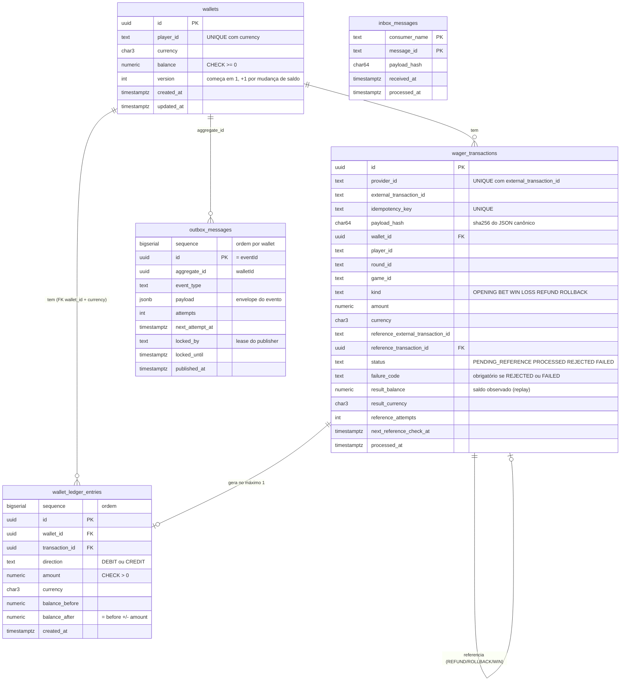

# Banco de dados

SQL completo (gerado com `pg_dump --schema-only` depois de todas as migrations): **[`schema.sql`](schema.sql)**.
As migrations, que são a fonte da verdade, ficam em `src/infrastructure/persistence/migrations/`.

## Diagrama



## Para que serve cada tabela

| Tabela | Papel | Pode apagar/alterar? |
|---|---|---|
| `wallets` | Saldo materializado de cada jogador por moeda | Nunca apagar. O saldo só muda com +1 na versão **e** com um lançamento no ledger |
| `wager_transactions` | Toda operação recebida (inclusive rejeitadas e `FAILED`), com o resultado para replay | Nunca apagar. Depois de terminal, nada muda |
| `wallet_ledger_entries` | O livro-razão: cada centavo que entrou ou saiu | **Nunca**: `UPDATE`, `DELETE` e `TRUNCATE` são bloqueados por trigger |
| `inbox_messages` | Dedup das mensagens SQS já processadas | Limpeza automática após 15 dias |
| `outbox_messages` | Eventos esperando publicação (mesma transação do saldo) | Limpeza automática das publicadas após 7 dias |

## O que o banco garante sozinho (mesmo com bug no código)

| Garantia | Como |
|---|---|
| Saldo nunca negativo | `CHECK (balance >= 0)` |
| 1 wallet por jogador + moeda | `UNIQUE (player_id, currency)` |
| Mesma operação não entra 2 vezes | `UNIQUE (idempotency_key)` e `UNIQUE (provider_id, external_transaction_id)` |
| Saldo sempre igual ao ledger | *constraint trigger* adiado para o **COMMIT**: `wallets.balance` = `balance_after` do último lançamento |
| Conta do lançamento fecha | `CHECK (balance_after = balance_before ± amount)` |
| Ledger encadeado | trigger: `balance_before` de cada lançamento = `balance_after` do anterior |
| Ledger imutável | triggers bloqueiam `UPDATE`, `DELETE`, `TRUNCATE` |
| Uma reversão por referência | índice único parcial em `reference_transaction_id` (REFUND/ROLLBACK processados) |
| Estado final não muda | trigger bloqueia `UPDATE` em transação `PROCESSED`/`REJECTED`/`FAILED` |
| Moeda do lançamento = moeda da wallet | FK composta `(wallet_id, currency)` |

## Consultas úteis para inspecionar

Conecte com `docker compose exec postgres psql -U wagering -d wagering` e rode:

```sql
-- Saldo de cada wallet x saldo reconstruído pelo ledger (devem ser iguais)
select w.id, w.balance,
       coalesce(sum(case when l.direction = 'CREDIT' then l.amount else -l.amount end), 0) as saldo_pelo_ledger,
       w.version
  from wallets w
  left join wallet_ledger_entries l on l.wallet_id = w.id
 group by w.id
 order by w.created_at desc
 limit 20;

-- Extrato de uma wallet (substitua o id)
select sequence, direction, amount, balance_before, balance_after, created_at
  from wallet_ledger_entries
 where wallet_id = '<wallet-id>'
 order by sequence;

-- Transações por status e tipo
select status, kind, count(*) from wager_transactions group by status, kind order by status, kind;

-- Rejeições e o motivo
select failure_code, count(*) from wager_transactions where failure_code is not null group by failure_code;

-- Transações aguardando a referência (fora de ordem)
select external_transaction_id, kind, reference_external_transaction_id, reference_attempts, next_reference_check_at
  from wager_transactions where status = 'PENDING_REFERENCE';

-- Fila de eventos ainda não publicados (outbox lag)
select event_type, count(*), min(occurred_at) as mais_antigo
  from outbox_messages where published_at is null group by event_type;

-- Prova da imutabilidade: deve dar erro
update wallet_ledger_entries set amount = 1 where false;
```
